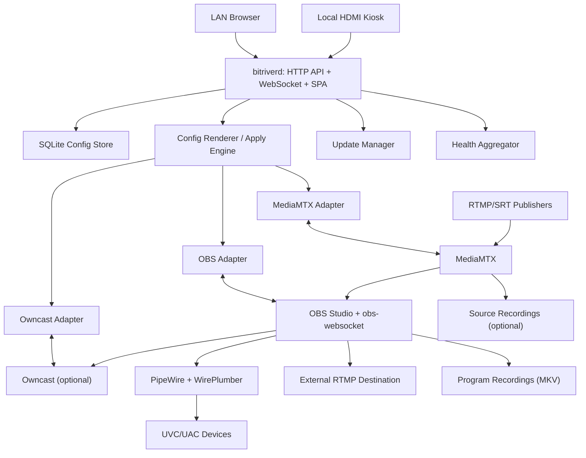

# BitRiver Studio OS Architecture

## Architectural Intent

BitRiver Studio OS is a single-purpose appliance OS for live production. The architecture deliberately separates:

- a control plane that owns configuration, orchestration, status, and browser UX
- a media plane that moves, mixes, encodes, records, and routes audio/video

The fastest credible MVP is not a custom media engine. It is a disciplined packaging of proven components behind one product model and one local API.

## Core Technology Choices

| Component | Choice | Why |
| --- | --- | --- |
| Base OS | Fedora-based `bootc` appliance image | Immutable root, signed image updates, reproducible builds, rollback-friendly deployments, strong PipeWire and OBS packaging |
| Init and supervision | `systemd` | Native service ordering, restart behavior, journal integration, health gating |
| Control daemon | `bitriverd` in Go | Small static binary, easy local HTTP/WebSocket API, straightforward process supervision and config rendering |
| Local UI | TypeScript SPA served by `bitriverd` | One deployment artifact for browser control, no external web server required for MVP |
| Local kiosk | `sway` + Chromium in kiosk mode | Boots directly into the BitRiver UI without exposing a desktop shell |
| Production engine | OBS Studio + `obs-websocket` | Battle-tested scene switching, recording, encoder support, existing remote control API |
| Device graph | PipeWire + WirePlumber | Modern Linux audio/video graph with better appliance routing options than PulseAudio |
| Network ingest and routing | MediaMTX | Solid ingest server for RTMP and SRT, path routing, session visibility, and source recording |
| Optional self-hosted destination | Owncast | Existing self-hosted live platform with a well-understood local deployment model |
| Config store | SQLite + rendered generation files | Transactional writes plus easy projection into OBS, MediaMTX, and Owncast configs |

## High-Level Service Graph



## Control Plane vs Media Plane

### Control Plane

The control plane is everything that decides what the system should do:

- `bitriverd` API server
- browser UI
- configuration storage and validation
- config rendering and apply logic
- update orchestration
- health aggregation
- support bundle generation
- first-boot claim flow and auth

The control plane never becomes the primary path for live media. It sends commands, reads status, and manages config generations.

### Media Plane

The media plane is everything that actually handles audio/video:

- OBS for scenes, composition, outbound streaming, and final program recording
- PipeWire and WirePlumber for local device graph management
- MediaMTX for contributor ingest, local routing, and optional source recording
- Owncast, when enabled, as a local downstream live destination

This boundary matters because the browser UI can restart independently without interrupting the live media graph, and configuration changes can be applied in a disciplined way instead of wiring raw media through the API server.

## Boot Flow

1. UEFI firmware boots the currently selected BitRiver deployment from the local disk.
2. The Linux kernel and initramfs mount the immutable root and the persistent partitions:
   - `/var` for system state
   - `/data` for recordings and large media artifacts
3. `systemd` reaches early boot targets and starts:
   - `systemd-networkd`
   - `systemd-resolved`
   - `avahi-daemon`
   - firewall rules
4. `bitriver-bootstrap.service` runs once per boot to:
   - validate or generate appliance identity
   - detect first-boot state
   - run config and schema migrations
   - materialize the active rendered config generation
5. `pipewire.service` and `wireplumber.service` start under the dedicated `studio` user.
6. `sway.service` starts the locked-down graphical session.
7. Within the `sway` session:
   - OBS starts hidden on a non-interactive workspace
   - Chromium starts in full-screen kiosk mode pointed at `http://127.0.0.1/`
8. `mediamtx.service` starts with the rendered ingest configuration.
9. `owncast.service` starts only when enabled in the active config.
10. `bitriverd.service` starts and serves the SPA, API, and event stream.
11. `bitriver-healthcheck.service` confirms that:
   - `bitriverd` is serving locally
   - `obs-websocket` responds
   - MediaMTX API is healthy
   - storage is mounted and writable
12. If the system booted into a candidate update, `bitriver-boot-ok.service` marks the deployment healthy only after the health checks pass and the config migration completes.

## Why This Boot Model

- The kiosk experience satisfies "boot directly into BitRiver" without shipping a desktop UX.
- OBS still runs in a real graphical session, which is more practical than inventing a headless rendering stack for MVP.
- Keeping OBS and Chromium in the same locked-down session avoids exposing a general-purpose shell to operators.
- The appliance still remains fully operable from any browser on the LAN.

## Service Responsibilities

### `bitriverd`

`bitriverd` is the product brain. It owns:

- authentication and session management
- REST and WebSocket APIs
- config draft and apply flows
- OBS command translation through `obs-websocket`
- MediaMTX status polling and path management
- update checks and staged install orchestration
- system health summaries
- support bundle generation

`bitriverd` is the only service the UI talks to directly.

### OBS Studio

OBS remains the authoritative runtime for:

- scenes and source composition
- stream start and stop
- program recording
- encoder selection
- audio mixer operations exposed in MVP

OBS is configured from generated profiles and scene collections plus runtime commands sent through `obs-websocket`.

### MediaMTX

MediaMTX handles:

- guest and contributor ingest over RTMP and SRT
- local path naming and session visibility
- optional source recording for ingest paths
- stable URLs that BitRiver can present in the UI

In MVP, MediaMTX is not the primary outbound streaming engine. OBS streams directly to either an external RTMP destination or local Owncast.

### PipeWire and WirePlumber

PipeWire provides the appliance's local device graph. In MVP it is used for:

- enumerating local USB audio and video devices
- stable device handling through policy
- predictable audio input/output exposure to OBS
- future-proofing for richer routing without building on PulseAudio-era assumptions

### Owncast

Owncast is an optional bundled service. When enabled:

- OBS can target the local Owncast RTMP endpoint as its live destination
- the BitRiver UI can surface Owncast URL and health
- Owncast data lives in persistent storage but remains logically optional

## Local API Design

The browser talks only to `bitriverd` over HTTP and WebSocket on the appliance LAN address.

### API Principles

- JSON over HTTP for commands and configuration.
- WebSocket event stream for near-real-time updates.
- One API version prefix from day one: `/api/v1`.
- Command endpoints return immediately with operation status when work may take time.
- Internal service APIs such as `obs-websocket` and MediaMTX HTTP stay bound to localhost and are never exposed directly.

### Authentication Model

- First boot exposes a claim flow.
- Claim requires a short one-time code shown on the local HDMI screen.
- After claim, the operator sets the admin password.
- Normal login creates an HTTP-only session cookie.
- Sessions are same-origin and protected with CSRF tokens for mutating requests.

This is intentionally LAN-first. Remote WAN exposure is unsupported in MVP.

### Core Read Endpoints

- `GET /api/v1/system`
  Returns appliance identity, version, uptime, temperatures where available, and overall health.
- `GET /api/v1/show`
  Returns active scene, stream state, record state, destination state, and source readiness.
- `GET /api/v1/sources`
  Returns discovered local devices and configured ingest slots.
- `GET /api/v1/audio`
  Returns mixer channels, mute state, and current levels.
- `GET /api/v1/storage`
  Returns disk capacity, recording usage, and retention warnings.
- `GET /api/v1/updates`
  Returns current version, channel, available update info, and staged candidate state.
- `GET /api/v1/config/active`
  Returns the current active config generation.
- `GET /api/v1/config/draft`
  Returns the editable draft generation.

### Core Mutating Endpoints

- `POST /api/v1/setup/claim`
- `POST /api/v1/session/login`
- `POST /api/v1/session/logout`
- `PUT /api/v1/config/draft`
- `POST /api/v1/config/validate`
- `POST /api/v1/config/apply`
- `POST /api/v1/show/scene/{sceneId}/activate`
- `POST /api/v1/show/stream/start`
- `POST /api/v1/show/stream/stop`
- `POST /api/v1/show/recording/start`
- `POST /api/v1/show/recording/stop`
- `POST /api/v1/audio/{channelId}/mute`
- `POST /api/v1/audio/{channelId}/unmute`
- `POST /api/v1/audio/{channelId}/gain`
- `POST /api/v1/updates/stage`
- `POST /api/v1/updates/reboot-into-staged`
- `POST /api/v1/system/reboot`
- `POST /api/v1/system/factory-reset`
- `POST /api/v1/support-bundle`

### Event Stream

`GET /api/v1/events` upgrades to WebSocket and publishes:

- `system.health`
- `system.temperature`
- `obs.stream_state`
- `obs.record_state`
- `obs.scene_changed`
- `obs.audio_levels`
- `mediamtx.path_state`
- `storage.disk_state`
- `update.state`
- `operation.completed`

The UI should be able to paint the main dashboard entirely from an initial read snapshot plus these events.

## Configuration Model

### Canonical Source of Truth

The canonical config lives in SQLite at:

- `/var/lib/bitriver/state.db`

SQLite stores:

- appliance metadata
- the active config generation
- one mutable draft generation
- operation history
- non-exportable secrets references

### Rendered Generations

Each successful apply creates a rendered generation directory under:

- `/var/lib/bitriver/generations/<generation-id>/`

That directory contains:

- `obs/profile/`
- `obs/scene-collection.json`
- `mediamtx/mediamtx.yml`
- `owncast/config.yaml` when enabled
- `manifest.json` with checksums and generation metadata

The active generation is a symlink:

- `/var/lib/bitriver/current -> /var/lib/bitriver/generations/<generation-id>`

This makes rollback explicit and auditable.

### Persisted Config Shape

At a high level the config includes:

```json
{
  "system": {
    "name": "studio-a",
    "timezone": "America/Denver",
    "update_channel": "stable"
  },
  "sources": [
    {
      "id": "cam-host",
      "kind": "local_video",
      "device_ref": "usb-046d_0825-hostcam"
    },
    {
      "id": "guest-1",
      "kind": "network_ingest",
      "protocols": ["rtmp", "srt"]
    }
  ],
  "scenes": [
    {
      "id": "host-cam",
      "sources": ["cam-host", "mic-host"]
    }
  ],
  "audio": {
    "channels": [
      {
        "id": "mic-host",
        "device_ref": "usb-focusrite-2i2-input-1"
      }
    ]
  },
  "destination": {
    "mode": "external_rtmp"
  },
  "recording": {
    "container": "mkv",
    "path": "/data/recordings"
  },
  "owncast": {
    "enabled": false
  }
}
```

### Device References

Config does not store raw `/dev/video*` names as stable identifiers. It stores normalized hardware references derived from udev properties so devices survive reboots and enumeration order changes.

### Apply Pipeline

1. UI edits the draft generation.
2. `POST /api/v1/config/validate` performs schema validation and environment checks.
3. `POST /api/v1/config/apply` creates a new generation if validation succeeds.
4. `bitriverd` renders service-specific configs into a staging generation directory.
5. `bitriverd` applies what can be changed live through APIs first.
6. Services that require reload or restart are updated in a fixed order:
   - MediaMTX
   - Owncast if enabled
   - OBS profile and scene material
7. Health checks run against the new generation.
8. If checks fail, the symlink remains on the old generation and the apply is marked failed.

This is intentionally generation-based instead of mutating service config files in place.

## OBS Runtime Model

OBS is the only process that owns the final composed program.

### Practical MVP Decisions

- Program recording is always OBS-based, not delegated to MediaMTX.
- Program recordings default to MKV for crash safety.
- OBS is shipped with a minimal curated plugin set:
  - `obs-websocket`
- End-user plugin installation is disabled in MVP.
- Scene collections are generated from BitRiver config and then adjusted through `obs-websocket` when possible.

### Crash Recovery

If OBS exits unexpectedly:

1. `systemd` restarts it.
2. `bitriverd` waits for `obs-websocket` readiness.
3. The last active generation is re-applied.
4. The last active scene and mute state are restored.
5. If recording had been active, BitRiver offers explicit resume rather than pretending no interruption occurred.
6. If external live streaming had been active, BitRiver surfaces the session as degraded and requires operator confirmation to restart outbound streaming.

This is safer than silently reconnecting to live platforms after a process crash.

## MediaMTX Runtime Model

MediaMTX exists to make network contributors predictable.

### Ingest Path Strategy

MVP uses named ingest slots instead of free-form runtime path creation:

- `guest-1`
- `guest-2`
- `remote-cam-1`
- `backup-feed`

For each slot BitRiver can expose:

- RTMP publish URL
- SRT publish URL
- connection state
- bitrate and recent activity
- optional source recording status

### How OBS Consumes MediaMTX Inputs

BitRiver generates OBS source definitions that point at the local MediaMTX path endpoints. The initial implementation should use appliance-local RTSP URLs consumed by OBS FFmpeg sources, because that is the most straightforward reconnect-friendly path without introducing extra OBS plugins. This keeps network ingest stable even if contributor connections flap, because OBS references the appliance-local path rather than a directly connected remote source.

## Update Model

### Artifact Strategy

The update artifact is the whole appliance image, not a piecemeal package transaction.

That means:

- kernel, userspace, BitRiver services, OBS, MediaMTX, PipeWire, and kiosk runtime move together
- there is no supported `apt upgrade` or `dnf install` flow on the live appliance
- update testing is done against full-image versions

### Update Flow

1. `bitriverd` checks the configured channel for a signed update manifest.
2. The appliance downloads the candidate image to an inactive deployment.
3. Signature verification and checksum validation run before staging completes.
4. The UI shows the staged version and asks for reboot timing.
5. On reboot, the bootloader selects the staged deployment.
6. Boot health validation waits for:
   - successful root mount
   - config migration success
   - `bitriverd`, OBS, and MediaMTX health
7. If validation passes, the candidate becomes the new current deployment.
8. If validation fails, the boot target flips back to the previous deployment automatically.

### User-Facing Rules

- Updates cannot auto-reboot during an active stream or recording.
- If a stream or recording is active, staging is allowed but reboot is blocked.
- Rollback is exposed in the UI as "boot previous version" rather than a hidden support operation.

## Factory Reset Model

Factory reset must be predictable enough for resale, redeploy, or catastrophic config cleanup.

### Reset Behavior

Factory reset does the following:

- clears BitRiver config generations
- removes stored passwords and destination secrets
- removes Owncast runtime data when enabled
- clears cached logs beyond the default journal vacuum behavior
- regenerates appliance identity on next boot
- returns the system to first-boot claim state

### Recording Preservation

MVP supports two reset modes:

- reset and preserve recordings in `/data/recordings`
- reset and wipe recordings

The UI must make the choice explicit and irreversible.

## Threat Model

### Assets Worth Protecting

- administrative control of the appliance
- stream keys and destination credentials
- recorded media
- software update trust
- contributor ingest URLs

### Expected Adversaries

- another device on the same LAN
- an unauthorized person with physical access
- a malicious contributor publishing to an ingest path
- a compromised browser session on an operator laptop
- a bad or tampered update artifact

### Security Posture for MVP

- LAN-first trust model, not internet exposure.
- Setup claim code shown on the local HDMI output.
- Strong admin password required after claim.
- Session cookies marked `HttpOnly` and `SameSite=Strict`.
- CSRF tokens required for all mutating requests.
- Content Security Policy on the UI to limit script injection.
- Browser source allowlist in config to reduce arbitrary remote content usage.
- Internal service endpoints bound to localhost only.
- Firewall only opens:
  - web UI port
  - configured RTMP and SRT ingest ports
  - optional Owncast web and ingest ports when enabled
- Services run as dedicated users wherever practical.
- Full-image updates are signature-verified before staging.

### Explicit MVP Limitations

- No TLS certificate automation in the box for LAN access.
- No zero-trust remote access story in MVP.
- No disk encryption assumption for unattended theft defense.

These are acceptable only because WAN exposure is out of scope and the target deployment is a trusted local production network.

## Observability Model

Observability has to help an operator during a show, not just a developer after the fact.

### Operator-Facing Status

The dashboard should surface:

- active scene
- stream state and destination reachability
- record state and remaining disk space
- source readiness and ingest connection status
- CPU load, memory pressure, and temperatures where available
- OBS dropped frames and encoder stress
- recent errors and warnings

### Logs

- `bitriverd` logs structured JSON to journald.
- OBS, MediaMTX, Owncast, and system services log to journald with unit names preserved.
- Journal retention is size-limited so logs cannot crowd out recordings.

### Metrics

`bitriverd` exposes a local metrics endpoint for future scrape support. MVP uses it internally for the dashboard rather than requiring Prometheus from day one.

Suggested metric groups:

- system CPU, memory, storage, and temperature
- OBS stream and record state
- OBS render and encoding warnings
- MediaMTX session counts and bitrate
- update staging state

### Preview Model

MVP browser preview is intentionally conservative:

- scene confidence thumbnails come from `obs-websocket` screenshot APIs
- audio levels and state changes are real time through the event stream
- full-motion browser multiview is deferred until a low-latency path proves stable on supported hardware

This keeps the first release focused on reliable control instead of overselling remote monitoring fidelity.

### Support Bundle

The support bundle contains:

- appliance version and hardware summary
- active config manifest with secrets redacted
- current and previous boot logs
- relevant service logs
- disk and mount information
- device inventory

This is the primary support artifact for GitHub issue reports and debugging.

## Hardware Assumptions

The architecture is intentionally narrow for MVP.

### Supported Appliance Class

- x86_64 mini PC
- UEFI boot
- wired gigabit Ethernet
- NVMe SSD
- integrated GPU with usable VAAPI path

### Minimum Recommended Hardware

- Intel N100, Intel N305, or AMD Ryzen 5 5600U class CPU or better
- 16 GB RAM
- 500 GB NVMe SSD
- 1 GbE networking
- one physical HDMI output or an HDMI dummy plug

### Why the HDMI Requirement Exists

For MVP, OBS is run in a real graphical session because that is the shortest path to dependable Linux behavior. If the appliance is deployed headless, an HDMI dummy plug should be treated as part of the supported bill of materials.

### Supported Peripheral Assumptions

- UVC webcams and capture cards
- UAC audio devices and USB interfaces
- HDMI capture devices that expose both video and audio through standard Linux interfaces

### Explicitly Deferred Hardware

- NVIDIA-first support
- DeckLink capture and output
- SDI routing hardware
- Wi-Fi-first deployments
- ARM boards

## Failure Modes and Recovery

### Power Loss

- The immutable root is unaffected.
- The active generation remains intact.
- OBS program recordings are in MKV to reduce corruption risk.
- On boot, BitRiver returns to the last known-good configuration.

### Control Plane Crash

- `bitriverd` restarts under `systemd`.
- Media services continue running.
- The UI reconnects through the event stream.

### MediaMTX Crash

- `systemd` restarts MediaMTX.
- Ingest slots come back with the same published paths.
- OBS source references remain stable because they point at local path names.

### Failed Config Apply

- The new generation never becomes current.
- Operators remain on the last known-good runtime.
- The UI surfaces the validation or health-check failure clearly.

### Failed Update Boot

- Candidate deployment is not marked healthy.
- The boot target falls back to the previous deployment.
- The UI reports the rollback after the next successful boot.

## Fastest Path to a Real MVP

To move quickly without painting the product into a corner, build in this order:

1. Immutable bootable image with `bitriverd`, kiosk shell, OBS, MediaMTX, and PipeWire.
2. First-boot claim flow and browser dashboard with health basics.
3. OBS control through `obs-websocket` for scene switching, streaming, and recording.
4. MediaMTX ingest slot management and browser visibility.
5. Config generations and safe apply pipeline.
6. Staged updates and rollback validation.
7. Factory reset and support bundle.

That sequence delivers a demoable appliance early while preserving the architecture required for long-term reliability.
