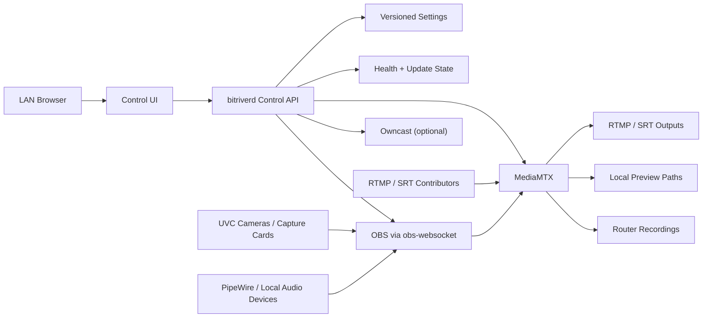
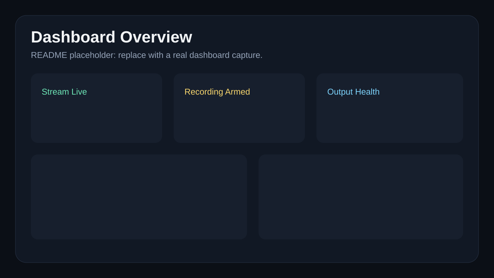
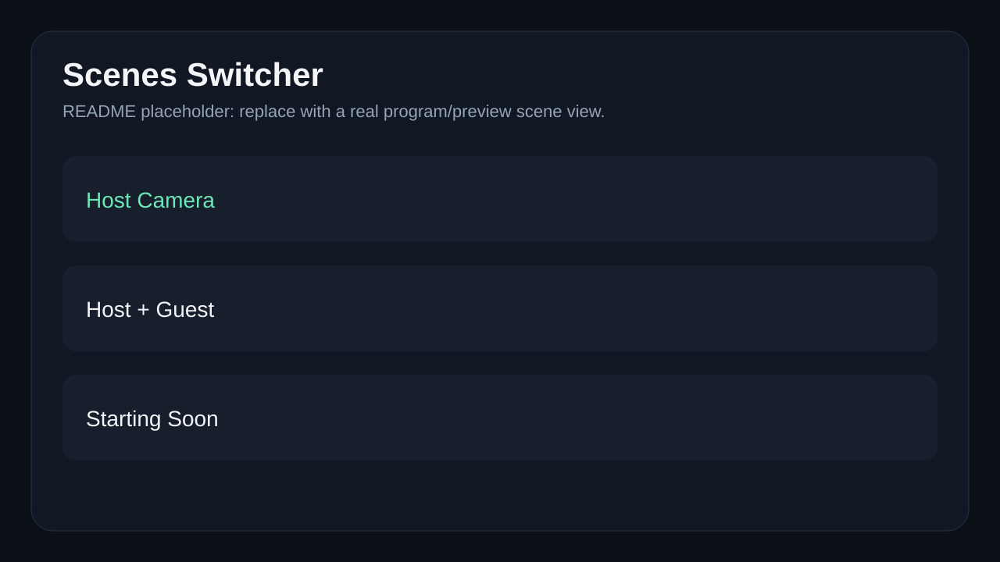
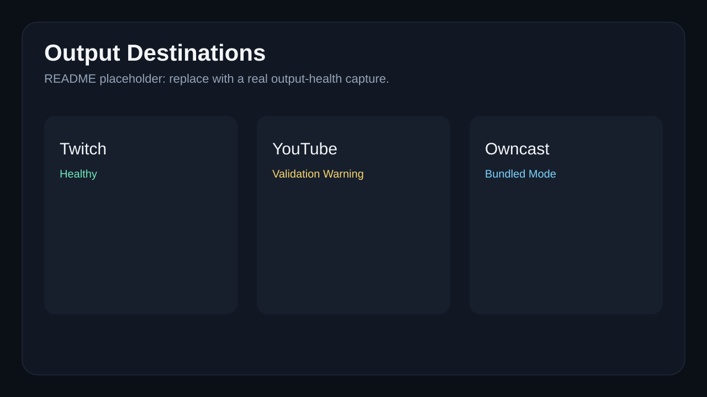
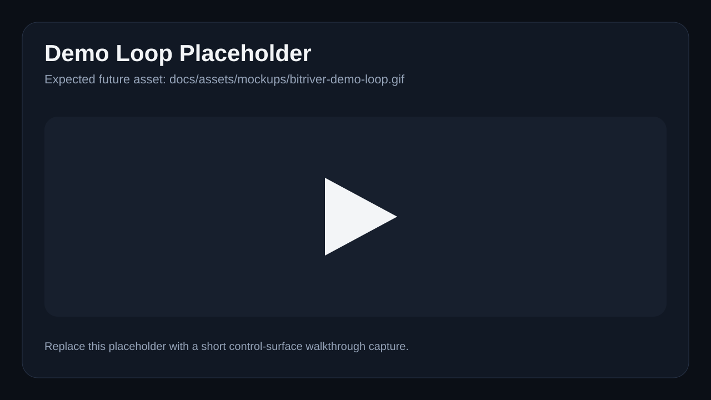

<p align="center">
  
</p>

# BitRiver Studio OS

<p align="center"><strong>Open-source-first creator and broadcast OS for real PCs.</strong></p>

BitRiver Studio OS is a bootable, self-hosted broadcast appliance that turns a small x86_64 PC into a dedicated live production box controlled from a browser on the LAN.

General-purpose streaming rigs are powerful, but they are also the source of most avoidable show-day anxiety. Desktop OS updates land at the wrong time. USB devices reorder themselves. Audio routing drifts. Remote control turns into a remote desktop session. What starts as a flexible creator setup becomes an unreliable pile of software held together by muscle memory.

BitRiver Studio OS exists to package the useful parts of that stack into something narrower and safer: immutable image updates, direct boot into the product, OBS for real production control, MediaMTX for ingest and routing, and a browser-first control plane instead of a desktop workflow.

Brand assets and usage guidelines: [BitRiver visual identity](docs/BRAND_IDENTITY.md). The same mark appears in the bundled local control UI, operator sign-in, browser tab and OS image assets.

## Ready-to-use offline OBS scenes

New OS images contain four reviewed [OBS Scene Assets](docs/CREATOR_ASSETS.md)
starters—Starting Soon, Be Right Back, Just Chatting and Intermission—with
previews in the local Asset Studio. No GitHub access is required on first boot;
the full upstream scene catalog is optional. These provide OBS Browser Sources. An operator can explicitly install a
starter as a separate, inactive OBS scene, then switch to it from the Scene Rail;
nothing is installed or broadcast
automatically.

## Key Capabilities

- Boots like an appliance, not a workstation.
- Serves a LAN control plane for scene switching, streaming, recording, and health visibility.
- Uses OBS plus `obs-websocket` for the program engine instead of inventing a custom switcher.
- Uses MediaMTX for contributor ingest, local preview routing, downstream fanout, and router-level recording.
- Supports fixed RTMP and SRT ingest slots that are easier to operate than ad hoc URLs.
- Keeps settings versioned and file-backed so config apply, rollback, and recovery have a clear model.
- Runs with deterministic mock adapters for local development and repo demos, so contributors can see the product direction without a capture rig.

## Why BitRiver Exists

Independent creators deserve something between a fragile gaming PC and enterprise broadcast gear. BitRiver is aimed at the point where the workflow is serious enough to need predictable operations, but still small enough that the operator wants one box, one browser UI, and one system they can understand.

The goal is not to become a bloated media suite. The goal is to become the open broadcast appliance for independent creators.

## How It Works



The control plane never becomes the media plane. `bitriverd` manages configuration, health, events, and orchestration. OBS owns the live program. MediaMTX owns ingest, preview, and downstream routing. The browser talks to one local API.

## Current MVP Status

What is real in this repo today:

- Go control API with REST endpoints, WebSocket state streaming, structured logs, and mocked adapters for CI and local work.
- Production-grade OBS adapter built on `obs-websocket`.
- Managed MediaMTX integration with generated `mediamtx.yml`, safe reload-to-restart fallback, path and session inspection, and router health in the API.
- Immutable-image scaffold, appliance `systemd` units, first-boot state, and kiosk boot path.
- Typed shared contracts and an initial React control surface scaffold.
- Optional local Creator Asset Studio browser with metadata search, previews, copyable OBS URLs, and opt-in inactive OBS scene installation.

What is still in progress:

- A fully polished websocket-first control UI.
- PipeWire device discovery beyond the current groundwork.
- Update orchestration beyond the current service scaffold.
- Owncast destination flows as a first-class output path.
- Hardware certification and end-to-end appliance validation on target mini PCs.

## Creator Asset Studio (Optional)

BitRiver includes a Creator Asset Studio panel with four bundled starters and support for a **locally installed** full copy of [OBS Scene Assets](https://github.com/ProhibitedTV/OBS-Scene-Assets). Once the catalog is installed, the dashboard can search, filter, and preview designs and create copyable OBS Browser Source URLs with optional titles and subtitles. The control API serves PNG previews only, never overlay HTML. The operator can explicitly install an asset as a new OBS scene, but no scene is activated and no stream is started automatically.

See [docs/CREATOR_ASSETS.md](docs/CREATOR_ASSETS.md) for setup, API details, and security boundaries. An absent library does not affect live production.

## Try The Demo Locally

The repo already supports a local mock-driven demo path. The API runs in mock mode by default, which means you can exercise scene switching, stream state, recording state, source availability, and MediaMTX router state without OBS, capture cards, or a full appliance image.

### Prerequisites

- Go 1.22+
- Node.js 22+
- npm 10+
- PowerShell
- GNU Make

### Start The Demo

```bash
npm ci --ignore-scripts --no-audit --no-fund
go work sync
make dev-api
make dev-ui
```

Open `http://127.0.0.1:3000`.

Useful local commands:

- `make smoke` runs the API smoke and integration checks against the local mock stack.
- `make openapi` regenerates the shared API contract from the Go source.
- `make build` builds the API and UI artifacts that the appliance image consumes.

## Screenshots And Motion

These are the exact placeholder assets currently committed for the README and future demo captures:

| View | File |
| --- | --- |
| Dashboard overview | `docs/assets/mockups/dashboard-overview.svg` |
| Scene switching | `docs/assets/mockups/scenes-switcher.svg` |
| Audio panel | `docs/assets/mockups/audio-panel.svg` |
| Output destinations | `docs/assets/mockups/output-destinations.svg` |
| Recordings panel | `docs/assets/mockups/recordings-panel.svg` |
| Settings panel | `docs/assets/mockups/settings-panel.svg` |
| Demo motion placeholder | `docs/assets/mockups/bitriver-demo-loop.svg` |

| Asset | Placeholder |
| --- | --- |
| Dashboard |  |
| Scenes |  |
| Outputs |  |
| Demo Loop |  |

## Why This Is Different

- It is opinionated on purpose. BitRiver is not trying to be a Linux distribution for creators.
- It treats operational safety as a product feature, not a future polish pass.
- It keeps the browser UI as the primary operator surface instead of assuming remote desktop forever.
- It is built from proven media components, but the product model is appliance-first.
- It is open-source without pretending that "more knobs" automatically means a better production system.

## Roadmap

### Near Term

- Finish the first serious websocket-first control UI.
- Add deterministic demo mode flows that make the repo feel alive on first clone.
- Tighten hardware visibility, audio device modeling, and source diagnostics.
- Extend output validation so destination status reflects remote publish success, not just local router readiness.

### Mid Term

- Owncast as a clean optional destination mode.
- Safer image-update UX with staged apply, verification, and rollback visibility.
- Better browser-side preview and confidence monitoring.
- Certified mini PC and capture-device matrix.

### Long Term

- Multi-destination publishing.
- Stronger remote guest workflows.
- Better automation and show presets without turning BitRiver into a general-purpose media platform.

## Operator Login (Pre-release)

The appliance now gates its broadcast controls behind a local operator-key
sign-in. Offline key rotation and immediate session revocation are supported
from a trusted local appliance shell. First boot creates a random control key, and API actions require an
authenticated session with CSRF protection. The appliance binds to loopback
until a TLS access path is available; the secure login is not yet an official
remote-access or multi-user solution. See
[Operator authentication](docs/OPERATOR_AUTH.md) for setup and limitations.

## Try the VirtualBox Technical Preview

A **non-production x86_64 VDI disk** can be built from the fully assembled
Fedora bootc image after CI validates UEFI boot, BitRiver's local API, and
reboot persistence. The VirtualBox publishing workflow is release-gated and
publishes a separately generated disk, **never** the temporary privileged
QEMU test VM. It is intended for isolated NAT-based experimentation, not
real streams or internet-facing services.

Follow [VirtualBox download, setup, and login instructions](docs/VIRTUALBOX_PREVIEW.md)
and look for the clearly labeled technical preview under [Releases](https://github.com/ProhibitedTV/BitRiver-Studio-OS/releases).
A usable desktop/kiosk under VirtualBox remains unverified until tested there.

## Release Readiness

The project is pre-release; passing the API/UI CI suite does not certify a bootable appliance. The image now includes the first-boot hardware report utility and CI verifies its output contract and boot script syntax. Image-related PRs now attempt an OCI bootc image build using checksum-locked
MediaMTX and Owncast releases with provenance metadata. A separate UEFI smoke-test workflow now attempts to convert the OCI image to
a disposable QCOW2 and boot it under QEMU with firstboot/reboot checks.
The test disk is **not** published as an installer, and passing it does not
certify physical hardware or release readiness. Hardware validation,
security, and recovery testing remain release gates. See [docs/RELEASE_READINESS.md](docs/RELEASE_READINESS.md).

## Documentation

- [PRODUCT.md](PRODUCT.md)
- [ARCHITECTURE.md](ARCHITECTURE.md)
- [BOOTFLOW.md](BOOTFLOW.md)
- [HEALTHCHECKS.md](HEALTHCHECKS.md)
- [MEDIAPLANE.md](MEDIAPLANE.md)
- [OBS_SETUP.md](OBS_SETUP.md)
- [docs/api.md](docs/api.md)
- [docs/operations.md](docs/operations.md)
- [docs/troubleshooting.md](docs/troubleshooting.md)

## License

[MIT](LICENSE)

## Ordinary PCs and gaming rigs

BitRiver targets standard x86_64 desktops, gaming PCs, mini PCs and laptops,
not only dedicated streaming appliances. The hardware-inventory work records
**PCI GPU vendor/loaded driver, boot firmware mode, and wireless indicators**
in the local probe. This is inventory, **not** proof that hardware encoding,
OBS, Wi-Fi, or games work. Open-source Mesa and Fedora firmware are included;
no proprietary NVIDIA driver, Steam, or other external app is silently installed.

See [hardware compatibility plans](docs/HARDWARE_COMPATIBILITY.md).
