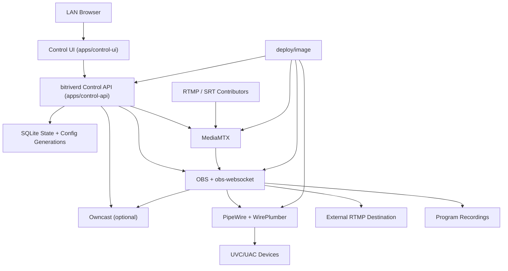
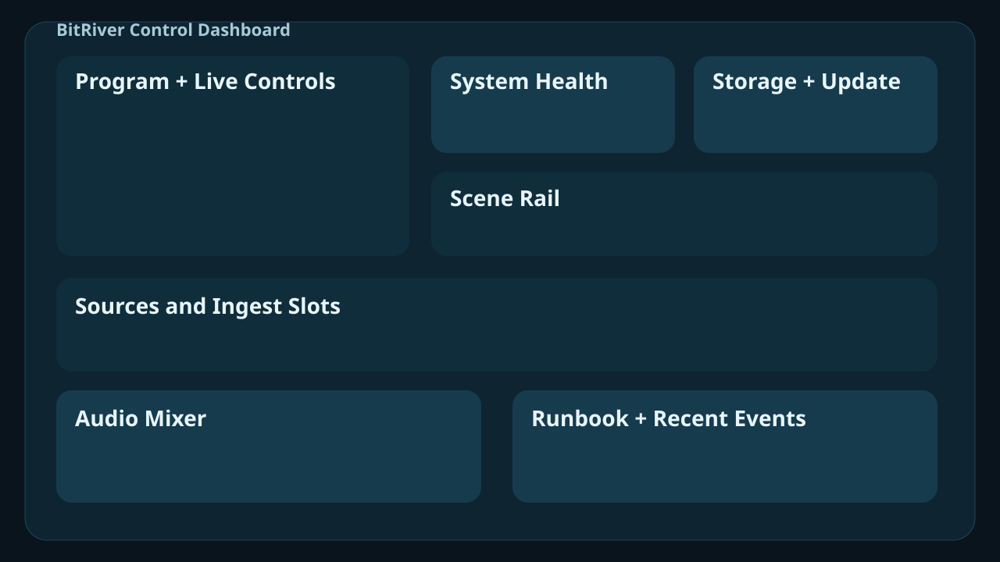
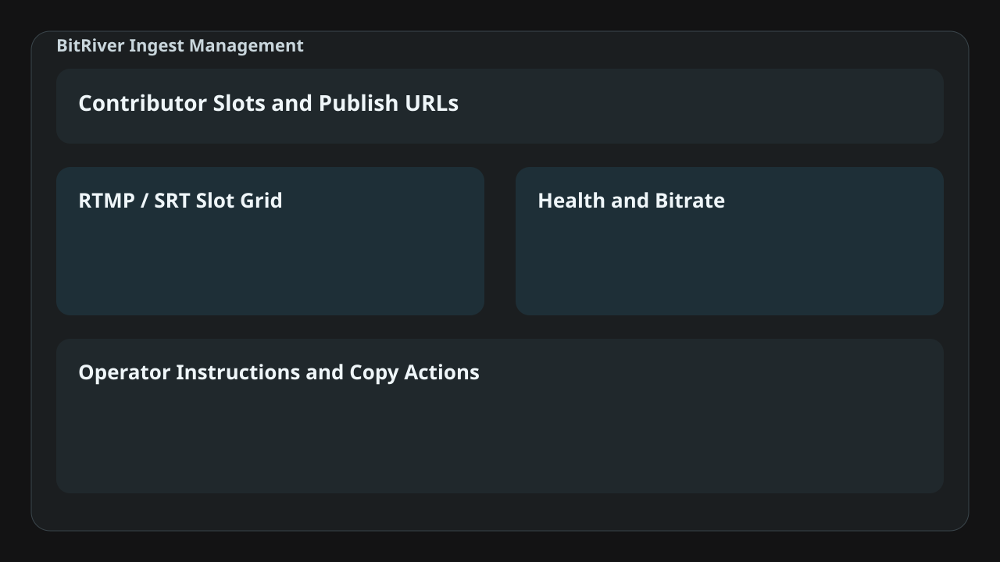
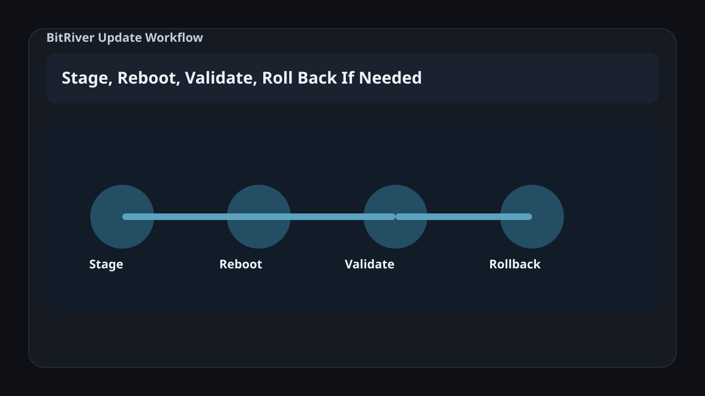

# BitRiver Studio OS

BitRiver Studio OS is a bootable, self-hosted production appliance for streamers. It turns a small x86_64 PC into a dedicated live broadcast box that boots directly into a browser-controlled control plane, routes contributor feeds with MediaMTX, drives production through OBS, and can optionally stream into a bundled Owncast instance.

This repository is the monorepo for the appliance image, control plane, browser UI, typed API contracts, deployment assets, and operational docs.

## Why It Exists

Streamers and small production teams regularly outgrow a fragile "desktop OS plus OBS plus capture tools plus remote desktop" stack long before they can justify a rack of broadcast gear. BitRiver Studio OS focuses on the middle ground:

- appliance UX instead of desktop UX
- browser-native control on the LAN
- safe updates and rollback
- predictable ingest, switching, recording, and recovery
- no cloud dependency for core operation

## Architecture



## Repository Layout

```text
apps/
  control-api/     Go control plane and local API server
  control-ui/      Vite + React browser control surface
packages/
  shared/          OpenAPI contract and shared TypeScript types
deploy/
  image/           bootc image build assets and rootfs overlay
  systemd/         appliance systemd unit files
config/
  examples/        realistic sample appliance configurations
docs/
  *.md             product, architecture, API, operations, troubleshooting
scripts/
  *.ps1            local development, lint, build, package, smoke automation
test/
  integration/     API lifecycle checks
  smoke/           fast endpoint and health checks
```

## Quickstart

### Prerequisites

- Go 1.22+
- Node.js 22+
- npm 10+
- PowerShell 7+
- GNU Make

### Install Tooling

```bash
npm install
go work sync
```

### Run the Control API

```bash
make dev-api
```

The API starts on `http://127.0.0.1:8080` with an in-memory appliance model that mirrors the MVP control surface.

### Run the Control UI

```bash
make dev-ui
```

The UI starts on `http://127.0.0.1:3000` and proxies `/api` requests to the local control API.

### Repo Checks

```bash
make lint
make build
make smoke
```

## Canonical Product Docs

- [PRODUCT.md](PRODUCT.md)
- [ARCHITECTURE.md](ARCHITECTURE.md)
- [docs/api.md](docs/api.md)
- [docs/operations.md](docs/operations.md)
- [docs/troubleshooting.md](docs/troubleshooting.md)

## Screenshots

The UI and image build are scaffolded in this repo. The screenshot slots below are committed as placeholders so the README structure is stable from the start.

| View | Placeholder |
| --- | --- |
| Dashboard overview |  |
| Ingest management |  |
| Update workflow |  |

## Implementation Priorities

1. Turn the Go control plane into the authoritative local API for config, health, and operations.
2. Replace the scaffolded UI polling loop with the live event transport defined in the architecture.
3. Wire appliance packaging in `deploy/image` to produce a bootable immutable image with the curated runtime stack.
4. Add adapters for OBS, MediaMTX, PipeWire, and Owncast behind the control API service boundaries already defined here.

## License

[MIT](LICENSE)
