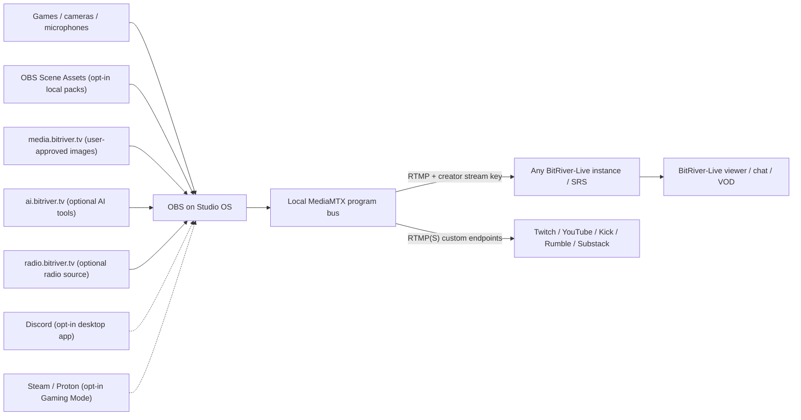

# BitRiver creator ecosystem — interoperability plan

**Status: first BitRiver-Live RTMP profile transport is implemented in this
branch; no cross-product authentication, unattended setup, or certified remote
broadcast exists.** The Studio OS remains useful offline and without any
BitRiver-hosted accounts.

## Shape of the ecosystem



These are separate, user-controlled services. **The domains are examples of
offerings, not default network destinations.** Studio OS should not send images
to an AI service, publish audio to radio, authenticate to a private account, or
clone other repos without an explicit choice.

## Native BitRiver-Live v1 publish contract

Existing [BitRiver-Live](https://github.com/ProhibitedTV/BitRiver-Live)
already accepts creator RTMP ingest and validates the publisher's channel key
through SRS. Its Creator Setup page displays an RTMP server plus a separate
private stream key. Studio OS already runs local OBS + MediaMTX and can
restream over RTMP using FFmpeg. The v1 integration reuses that transport.

The Live Creator page can export **only public connection metadata**:

```json
{
  "schemaVersion": "bitriver.studio.ingest/v1",
  "provider": "bitriver-live",
  "channelId": "0123456789abcdef0123456789abcdef",
  "rtmpServer": "rtmp://ingest.example.test:1935/live",
  "viewerUrl": "https://watch.example.test/viewer/channel"
}
```

This document deliberately contains **no stream key**, login token, session
cookie or other credential. The user picks their own Live instance and obtains
its actual RTMP server from that instance; the OS does not assume
`bitriver.tv` is hosting a public Live server.

### Prepare a destination on Studio OS

After downloading the JSON profile from a Live channel you own:

1. Transfer the profile to the Studio OS **local machine**, never to a public
   upload service. Open a trusted terminal on that machine.
2. Examine the JSON: only the five documented fields are permitted.
3. Test it without touching any credentials:

   ```bash
   python3 /usr/local/libexec/bitriver/import-bitriver-live-profile.py \
     --profile /path/to/studio-os-ingest.json --id live-primary --dry-run
   ```

4. As the **unprivileged `bitriver` service user**, run the same command
   without `--dry-run`. It prompts for your Live channel's 48-character
   stream key without echoing it:

   ```bash
   sudo -u bitriver python3 /usr/local/libexec/bitriver/import-bitriver-live-profile.py \
     --profile /path/to/studio-os-ingest.json --id live-primary
   ```

   The appliance uses its local bitriver user and private directory
   `/var/lib/bitriver/secrets/stream-keys/`, created with permissions
   `0700`. The new key file is `0600`. Do not run as root or paste the
   key into a shell command, screenshots or GitHub issue.

5. The command outputs a **disabled destination config fragment**, not a
   stream key. Review it and add it to
   `mediaRouter.publishDestinations` in a **draft** configuration using
   the authenticated local settings API
   (`GET /api/v1/settings/draft`, `PUT /api/v1/settings/draft`).
   The JSON includes a `streamKeyFile` reference, never the key.
   The admin session requires an operator login and CSRF on updates.
6. Explicitly validate the draft
   (`POST /api/v1/settings/validate`) and **apply** it
   (`POST /api/v1/settings/apply`) only after checking recording and
   on-air status. The initial fragment has `enabled: false`; switch it
   to `true` only when actually ready to publish.
7. With OBS sending program output to the local MediaMTX ingest, the
   restream worker appends the secret key to the RTMP server URL in
   memory and starts FFmpeg fan-out. Confirm actual SRS ingest, video,
   audio, chat and viewer playback on the chosen Live instance. A
   successful local health endpoint is **not** remote publish proof.

**Current limitations:** Config editing still uses the lower-level draft
API, not a polished sign-in wizard. Key files are kept out of config/API
responses but the FFmpeg process currently requires the full publisher URL
in local process arguments; **do not treat local multi-user process
isolation as solved**. Keys should be rotated after a possible exposure.
RTMP may be unencrypted; arrange TLS/RTMPS at the origin if supported or a
trusted transport when publishing over the internet. No direct BitRiver-Live
OAuth, stream lifecycle webhooks, chat synchronization or VOD handoff is
claimed yet. No real remote BitRiver-Live instance has been authenticated
or reached by CI.

## External streaming platforms

The existing MediaMTX/FFmpeg destination model allows **manually configured
RTMP/SRT fan-out**; it does not imply any provider account connection.

| Destination | v1 transport | Planned creator-native work |
| --- | --- | --- |
| BitRiver-Live (self-hosted instance) | Explicit RTMP server + separately stored channel key | Discovery via signed/verified manifest, health, channel state and playback |
| Twitch | Custom RTMP(S) endpoint | Preset, account-scoped ingest metadata, OAuth only with permission |
| YouTube Live | Custom RTMP(S) endpoint | Scheduled events, privacy and ingest readiness |
| Rumble | Custom RTMP endpoint | Event-specific stream URL/key and status |
| Kick | Custom RTMP(S) endpoint | Verified settings, rate/codec validation |
| Substack Live | Custom RTMP via eligible Substack live event | Event-specific RTMP/key and platform permission checks |
| Owncast / other | Existing adapter or custom RTMP/SRT | Verified multi-output readiness and retries |

Never hardcode platform ingest URLs or assume every user is eligible to stream.
Provider-specific encoder settings, transcoding, simultaneous broadcasting
permissions and service policies require separate validation.

## Creation and daily workflow

- **OBS** stays the production engine, scene graph and recording surface;
  keep native `obs-websocket` permissions separate from app logins.
- **OBS-Scene-Assets** already has a *read-only* local catalog/preview integration
  in [Creator Asset Studio](CREATOR_ASSETS.md). Phase 2 is a reviewed,
  pinned, offline-capable starter set of scenes (Starting Soon, BRB,
  Just Chatting, gaming/podcast/news); import into an inactive OBS scene
  collection with preview and rollback, rather than running arbitrary
  downloaded JavaScript in the authenticated dashboard.
- **media.bitriver.tv** offers user-selected imagery via an external media
  library; asset URLs may require authentication and licensing checks.
- **ai.bitriver.tv** is an optional Open WebUI/OpenAI-compatible tool
  destination *only after verifying its actual API contract*. Never
  bake private keys or prompts into the base image.
- **radio.bitriver.tv** is optional audio ingest; streaming/broadcast rights
  must be checked before including any radio content in a public stream.
- **Discord and Steam** are optional user-installed desktop applications.
  User account data and proprietary platform components are not default
  dependencies. Gaming/Creator Desktop modes need an actual desktop,
  sandboxing, Vulkan/Proton, GPU and permissions validation before launch.

## Next milestones

1. A first-run destination wizard that imports the key-free profile, prompts
   once for the secret and edits drafts without raw API calls.
2. Verify a full publish between two disposable instances: Studio OS OBS ->
   local MediaMTX -> BitRiver-Live SRS -> viewer playback and offline teardown.
3. Move publishing credentials out of FFmpeg's process argv into an
   isolated outbound worker; add secret rotation and redacted diagnostics.
4. Scene-pack installation with pinned upstream revision, integrity checks,
   non-executable previews, explicit source permission and rollback.
5. Creator Desktop / Gaming Mode, optional third-party apps and selected
   media, AI and radio resources.
6. Platform-specific presets, individual readiness probes and explicit
   multistream enablement. No destination or external service is active by
   default merely because its brand appears in the ecosystem.
